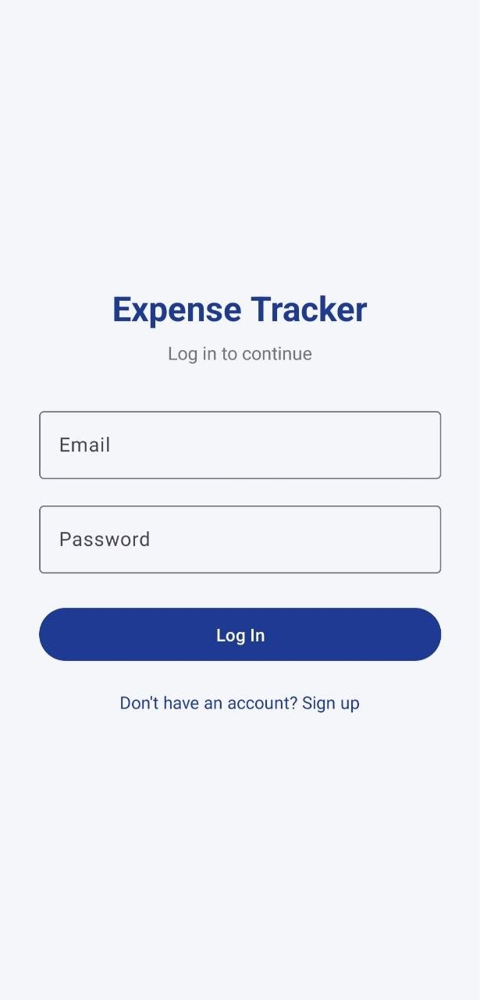
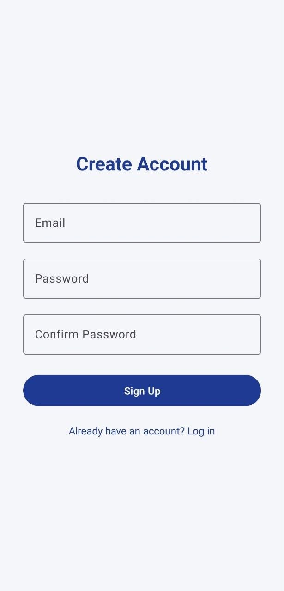
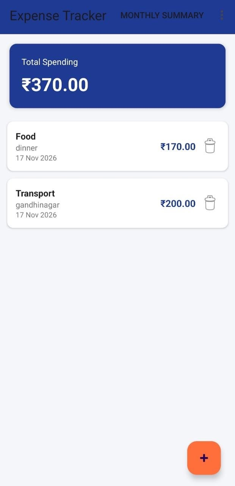
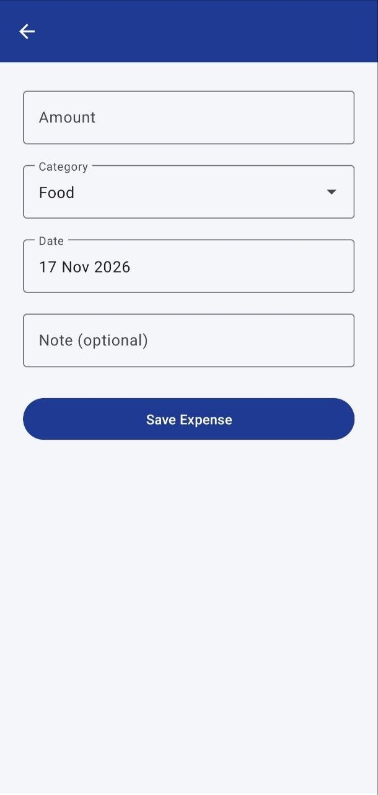
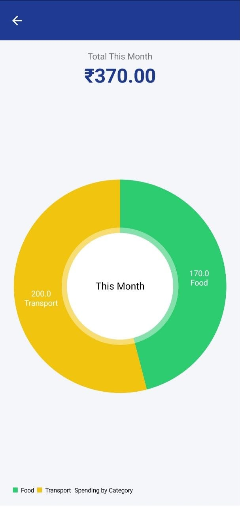

# Expense Tracker (Android)

A personal expense-tracking Android app built with Kotlin and Firebase. Users sign up, log expenses by category, and see their monthly spending as a chart.

## Features
- Sign up and log in with Firebase Authentication
- Add expenses with amount, category, date and an optional note
- View all expenses in a list with a running total, and delete entries
- Monthly summary with a donut chart of spending by category

## Screenshots
| Login | Sign up | Home |
|---|---|---|
|  |  |  |

| Add expense | Monthly summary |
|---|---|
|  |  |

## Tech Stack
- Kotlin
- Firebase Authentication
- Cloud Firestore
- Kotlin Coroutines
- Repository Pattern
- MPAndroidChart
- Material Design

## Architecture
Data access to Firestore is separated from the UI using the Repository Pattern, and Kotlin coroutines handle asynchronous operations.

## Run the project
1. Clone the repository and open it in Android Studio.
2. Create a Firebase project and add an Android app with this project's package name.
3. Enable Email/Password sign-in under Authentication and create a Cloud Firestore database.
4. Download `google-services.json` and place it in the `app/` folder. It is not included in this repository.
5. Sync Gradle and run the app on a device or emulator.

## Author
Savankumar Pittaliya
Android Application Developer | Dubai, UAE
[LinkedIn](https://www.linkedin.com/in/savan-pittaliya-10729141b)